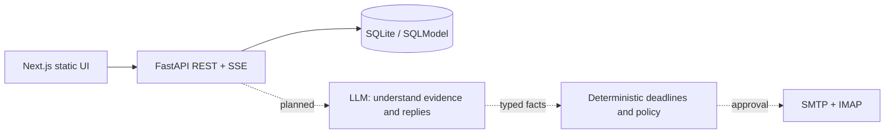

Forward a screenshot, rant in a voice note, and walk away. Shikayat files the complaint with the right officer, tracks deadlines, reads replies, catches stalling, and escalates toward a refund.

Current milestone: application scaffold. Case handling, email sending and AI evaluation are pending. Demo GIF, proof numbers, deployment and video links will be added after verification.

## Run locally

Requires Python 3.11 (via [uv](https://docs.astral.sh/uv/)), Node.js 20.9+ and npm.

```sh
cp .env.example .env
make setup
make dev
```

Open [localhost:3000](http://localhost:3000). FastAPI runs on port 8000; the frontend proxies `/api/*` in development. No credentials are needed for the scaffold.

```sh
curl http://localhost:8000/api/health
curl -N http://localhost:3000/api/events
make test
make build
```

Health returns `{"status":"ok"}`. SSE sends a `ping` event every 15 seconds. `make test` runs the backend smoke test, ESLint and TypeScript checks. `make build` creates `frontend/out`; restart FastAPI after building to serve the export at [localhost:8000](http://localhost:8000).

## Architecture



`backend/app` contains API, AI, engine, mail and demo packages. SSE uses a bounded, in-process pub/sub and requires **one backend worker**. SQLite lives in `var/shikayat.db`. Settings read the project-root `.env`; API keys and passwords use secret fields. Models are selected through environment variables; live extraction, classification and drafting use the OpenAI API. The frontend remains a separate mock workspace until case routes are wired into it.

## Data and safety

`data/companies.json` contains fictional ShopKart and the 25 specified real companies. All real contacts and unverified URLs are `null`. ShopKart uses `email_env: DEMO_COMPANY_EMAIL`; `load_companies()` resolves the configured address at runtime. Missing email still means no recipient. Legal seeds remain unverified with null source URLs, so none are eligible for citation yet.

The planned sending boundary requires approval for real recipients, demo-only allowlisted autopilot, verified non-null addresses and a global `SEND_ENABLED` switch. Email sending is not implemented in this scaffold.

## Environment

See `.env.example` for model, budget, mailbox and demo settings. `DATABASE_URL` can override SQLite's default path, and `FRONTEND_DIST` can override the static-export directory. Do not commit `.env`.

## Production

```sh
make docker
docker run --rm --env-file .env -p 127.0.0.1:8000:8000 -v shikayat-data:/app/var shikayat
```

The image builds Next.js then copies its export into the Python runtime. On EC2, set `DOMAIN` to your instance's actual `<ip>.sslip.io` hostname and run Caddy with the supplied `Caddyfile`. Point DNS at the instance and allow inbound ports 80/443; Caddy proxies to the local container with SSE flushing. HTTPS and Docker deployment require verification on the target host. `make deploy` currently prints this prerequisite; it does not provision infrastructure.

`make eval` is a placeholder reporting that evaluation is pending; no results or performance claims are fabricated.

## Next

Implement deterministic deadlines, strength and policy, then evidence intake and structured AI extraction. The target is a product built solo in 26 hours at Builders 2026 (OpenAI × Equal AI). Code freeze: **22 November 2026, 2:00 PM IST**.

## Mock UI walkthrough

The frontend now runs entirely on typed fixtures in `frontend/lib/mock.ts` and the provisional response contracts in `frontend/lib/types.ts`. Choose ShopKart, review/edit the email, approve the mock send, then use **Simulate next** for deflection, escalation and the offer. Confirm receipt in chat to close the case. **+48h** advances the visible demo clock; reset clears the in-memory cases. All delivery and recovery are explicitly simulated. Refresh resets the case workspace; onboarding dismissal is remembered locally.

Image attachments and MediaRecorder voice notes stay in the browser. Uploaded evidence is not extracted yet; choose a sample for the scripted journey. Microphone recording needs localhost or HTTPS and permission. Legal citations are omitted until their sources are verified. These TypeScript contracts must be aligned with future case API routes when those routes are implemented.

## Case understanding and sending API

`POST /api/cases` accepts multipart `images`, optional `audio`, and `text`. Configure `OPENAI_API_KEY`, `MODEL_SMART`, `MODEL_FAST`, and `MODEL_RATES_JSON` (verified USD/million-token input/output rates keyed by model name) for live calls. Responses parsing uses the installed SDK's typed Structured Outputs interface. Calls use a 30-second timeout and two SDK retries. Cache files and evidence live under ignored `var/`; the budget guard uses persisted cost estimates.

`POST /api/cases/sample/shopkart` (also `food`, `airline`) sends the synthetic screenshot and text through real AI when a key is configured. Responses and Events report `mode: live` or `mode: replay`. Explicit `REPLAY_MODE=true`, unavailable credentials, or an extraction API failure select the synthetic fallback. A disk cache hit retains live provenance; it is distinct from fixture replay. `POST /api/cases/{id}/draft` requires live AI configuration. `POST /api/cases/{id}/approve` requires configured Gmail sender credentials and a verified recipient; successful SMTP handoff creates threading metadata and deadlines. Classification, policy, inbox polling, deadline ticking and the demo company bot are connected as lifespan workers. `/api/demo/clock`, `/api/demo/inject` and `/api/demo/reset` require demo mode. `scripts/demo_e2e.py` drives the live hero flow and sends real email; configure the demo recipient in AUTOPILOT_ALLOWLIST for follow-ups. The live acceptance script uses real threaded SMTP/IMAP delivery, not reply injection. Its default 600-second wait accommodates Gmail delays; this is a verification allowance, not a three-minute demo performance claim.

## SQLite concurrency and verification

Every SQLite connection enables WAL, foreign keys and a 5000 ms busy timeout, with `check_same_thread=False`. Requests and workers close their read sessions before network calls; result writes use fresh, short transactions. Worker commit blocks share a single asyncio lock. Telemetry writes retry once, then save the charge under ignored `var/llm_pending/` without failing the pipeline; pending estimates count toward the budget guard.

Gmail workers discover All Mail and Spam by their special-use flags, fetch read-only in batches, and deduplicate RFC Message-ID headers. They do not depend on unread status. `scripts/verify_mail.py` tests both directions with 120 seconds of receipt polling. Worker failures are sanitized and exposed in the verification snapshot; workers stop after two errors. Diagnostic cases marked `verification_paused` do not trigger more automatic mail.

Run `make test`, `make build`, and (with configured credentials and a backend running) `.venv/bin/python scripts/demo_e2e.py` twice. Per-run audit and cost/cache/timing metrics are saved to ignored `var/verification/`. The live script confirms the fictional demo refund receipt for testing; it does not establish that a real payment occurred.
